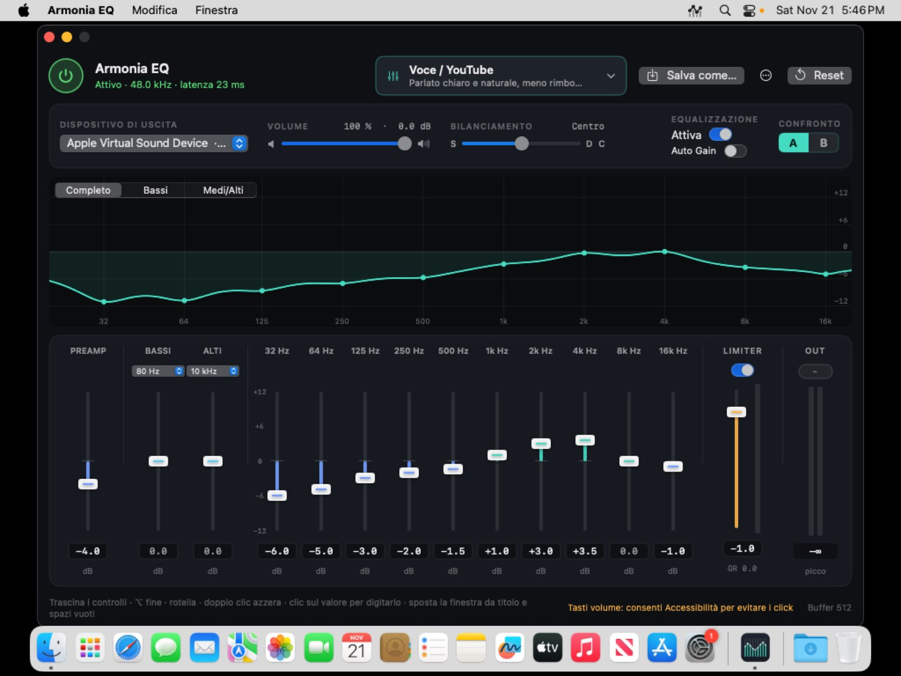
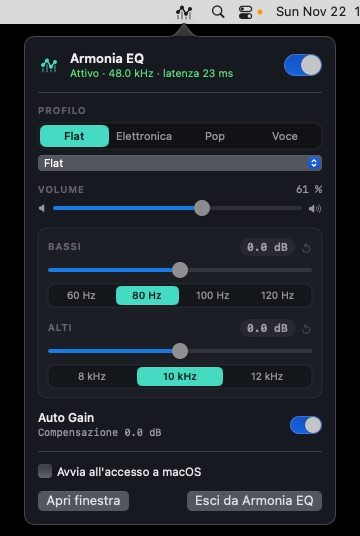

# Armonia EQ

Equalizzatore dell'audio di sistema per macOS 12 Monterey e successivi (Apple Silicon e Intel),
ispirato all'organizzazione di eqMac ma con grafica e codice originali.



Un'unica finestra, nessuna modalità separata: accensione, dispositivo di uscita, volume,
bilanciamento, menu dei profili, EQ grafico a 10 bande, preamp, limiter, analizzatore di spettro
e curva EQ sono sempre visibili.

## Come funziona (e perché serve BlackHole)

macOS 12 non ha un'API pubblica per catturare l'audio di sistema: la cattura audio di ScreenCaptureKit
arriva con macOS 13 e i "process tap" di Core Audio con macOS 14.2. L'unico metodo affidabile su
Monterey è un **driver audio di loopback**, la stessa architettura di eqMac (che installa il suo).
Armonia EQ usa il driver gratuito e open source **BlackHole 2ch**:

```
App (Safari, Musica, YouTube…) → uscita di sistema = BlackHole 2ch
  → aggregate device privato [uscita reale (clock) + BlackHole (compensazione deriva)]
  → AUHAL → DSP (preamp → EQ 10 bande → volume/bilanciamento → limiter)
  → altoparlanti interni / DAC USB / cuffie / HDMI
```

- Accendendo Armonia EQ, l'uscita di sistema passa su BlackHole; spegnendo o uscendo dall'app
  torna sul dispositivo reale (anche dopo una chiusura anomala, al riavvio successivo).
- Se scegli un'altra uscita dalle Impostazioni di Sistema mentre l'EQ è acceso, viene adottata
  come nuova uscita dell'EQ.
- Se scolleghi il dispositivo USB in uso, l'audio passa agli altoparlanti interni.
- **Volume.** BlackHole moltiplica l'audio catturato per il proprio controllo volume, con una legge
  lineare in dB da −64 a 0 dB: 50 % vale −32 dB e 25 % vale −48 dB. Mentre l'EQ è acceso, Armonia EQ:
  1. annulla esattamente quel guadagno all'ingresso del DSP (1/g, senza perdita in Float32);
  2. copia ogni variazione del volume di BlackHole (tasti volume, barra dei menu) sul **volume hardware
     del dispositivo reale**, per esempio EDIFIER M60, con la stessa curva dell'uscita diretta;
  3. all'avvio allinea BlackHole al volume attuale del dispositivo reale, senza mai cambiare quest'ultimo;
  4. allo spegnimento ripristina il volume originale di BlackHole.

  Il cursore "Volume" dell'app è un ulteriore guadagno digitale (100 % = 0 dB). Se il dispositivo
  non ha un volume hardware, i tasti volume non hanno effetto e si usa il cursore.

## Installazione

1. Installa BlackHole 2ch: `brew install blackhole-2ch` oppure il pacchetto da
   <https://existential.audio/blackhole/>.
2. Compila l'app (serve Xcode 13.2 o successivo; su Monterey va bene Xcode 14.2):

   ```bash
   git clone https://github.com/Bob818181/Armonia-EQ.git
   cd Armonia-EQ
   ./scripts/build_app.sh
   open build/ArmoniaEQ.app
   ```

   In alternativa scarica `dist/ArmoniaEQ.zip` dal repository (pubblicato dalla CI a ogni build
   riuscita, con la versione in `dist/BUILD.txt`) o l'artifact `ArmoniaEQ-app` di GitHub Actions. È firmata
   ad-hoc, non notarizzata: dopo averla scaricata esegui `xattr -cr ArmoniaEQ.app`.
3. Al primo avvio premi il pulsante di accensione. macOS chiede l'accesso al **Microfono**:
   per macOS BlackHole è un ingresso audio. Nessun microfono viene registrato.

## Profili

| Profilo | 32 | 64 | 125 | 250 | 500 | 1k | 2k | 4k | 8k | 16k | Preamp |
|---|---|---|---|---|---|---|---|---|---|---|---|
| Flat | 0 | 0 | 0 | 0 | 0 | 0 | 0 | 0 | 0 | 0 | 0 |
| Musica elettronica | +3.5 | +4 | +2 | −1 | −2 | −1 | 0 | +1 | +2.5 | +2.5 | −5 |
| Musica pop | +1 | +2.5 | +2 | 0 | −1 | 0 | +1.5 | +2.5 | +2 | +1.5 | −3 |
| Musica classica | 0 | 0 | 0 | −0.5 | −1 | 0 | 0 | +1 | +2 | +2.5 | −2.5 |
| Voce / YouTube | −6 | −5 | −3 | −2 | −1.5 | +1 | +3 | +3.5 | 0 | −1 | −4 |

- **Elettronica**: sub-bassi in evidenza, 250–500 Hz ridotti per evitare bassi gonfi, alti aperti.
- **Pop**: corpo nei bassi, 500 Hz leggermente ridotti, presenza delle voci a 2–4 kHz.
- **Classica**: nessuna enfasi dei bassi; più pulizia a 250–500 Hz, dettaglio e "aria" in alto.
- **Voce/YouTube**: meno rimbombo sotto i 125 Hz e meno suono ovattato a 250–500 Hz, zona di
  intelligibilità 1–4 kHz in evidenza, sibilanti e fruscio contenuti.

I filtri sono peaking larghi circa un'ottava, quindi bande vicine si sommano: la curva reale
è disegnata sopra l'analizzatore. Il preamp di ogni profilo è scelto sul picco **reale** della curva,
così il picco di curva + preamp resta tra 0 e +0,2 dB e il limiter interviene di rado.

**Manuale / Personalizzato**: curva libera, salvata automaticamente. Le modifiche a un profilo
predefinito non lo sovrascrivono mai. Il badge "MODIFICATO" compare e "Salva come…" crea un profilo
personale (es. *M60 – Voci limpide*). Dal menu `⋯` puoi rinominare, eliminare, gestire i profili,
ripristinare i valori del profilo o calcolare il preamp automatico.

Il file dei dati è `~/Library/Application Support/ArmoniaEQ/state.json`. Contiene i profili
personali, l'ultimo profilo, la curva, il volume e il dispositivo. Tutto viene ripristinato all'avvio.

## Comandi

- **Cursori EQ, PREAMP, BASSI e ALTI**:
  - si trascinano per regolare (con **⌥** la regolazione è più fine);
  - la **rotella** va a passi di 0,5 dB;
  - il **doppio clic** riporta a 0 dB;
  - un **clic sul valore** permette di digitarlo, poi Invio.
- **BASSI** (shelving basso) e **ALTI** (shelving alto):
  - vanno da −12 a +12 dB a passi di 0,5 dB;
  - la **frequenza di intervento** si sceglie dal menu sopra il cursore: BASSI 60 / **80** / 100 /
    120 Hz, ALTI 8 / **10** / 12 kHz (in grassetto i valori predefiniti). È indipendente dal
    guadagno: curva e audio cambiano subito, senza click;
  - sono indipendenti dai 10 cursori;
  - guadagno e frequenza si salvano nei profili personali e nei file esportati;
  - sono inclusi nella curva mostrata e vengono esclusi dal Bypass.
- **Confronto A/B**: due configurazioni temporanee della curva completa. Al primo passaggio, B parte
  come copia di A; le modifiche fatte in B restano in B e tornando ad A la si ritrova identica.
  Il cambio non produce click e non modifica i profili salvati. Dal menu `⋯` si può copiare una
  configurazione nell'altra o azzerare il confronto.
- **Auto Gain**: compensa la variazione di volume percepito prodotta dall'equalizzazione, così ogni
  profilo suona forte quanto Flat. È calcolato sulla curva (rumore rosa pesato K, ITU-R BS.1770) e
  applicato con una rampa lenta: niente pompaggio. Da spento non altera nulla. È diverso dal limiter,
  che agisce solo sui picchi.
- **OUT**:
  - **OK**: livello normale;
  - **LIM**: segnale oltre 0 dBFS contenuto dal limiter;
  - **CLIP**: clipping effettivo in uscita, possibile solo con il limiter spento.

  Sotto è indicato il picco massimo in dBFS: un clic azzera il picco e gli indicatori.
- **Spettro**: 60 fotogrammi al secondo, FFT a 8192 punti (bassi leggibili), ingrandimento Completo /
  Bassi (20–500 Hz) / Medi-Alti. Si ferma quando la finestra non è visibile.
- **Profili personali**:
  - salvano bande, preamp, BASSI, ALTI e limiter;
  - si possono rinominare, duplicare ed eliminare (con conferma);
  - si importano ed esportano in JSON dal menu `⋯` o da "Gestisci profili";
  - i profili predefiniti non sono modificabili;
  - restano dopo il riavvio, anche quelli delle versioni precedenti.
- **Icona nella barra dei menu** (accanto all'orologio): è il simbolo di Armonia EQ (barre e curva
  con punti, come l'icona dell'app), disegnato in vettoriale come immagine "template": si adatta a
  barra chiara/scura ed è attenuato quando l'equalizzazione è spenta. Un clic apre il pannello rapido:
  - accensione ON/OFF con stato e frequenza di campionamento;
  - **profili rapidi** Flat / Elettronica / Pop / Voce con un clic, più il menu completo (Classica,
    Manuale, profili personali);
  - volume;
  - BASSI e ALTI: valore in dB, cursore, azzeramento e **frequenza scelta con un selettore a
    segmenti** (60/80/100/120 Hz, 8/10/12 kHz);
  - interruttore **Auto Gain** con la compensazione applicata in dB;
  - "Avvia all'accesso a macOS", "Apri finestra" ed "Esci da Armonia EQ".

  
- **Tasti volume (senza click)**: con l'EQ attivo i tasti volume della tastiera sono gestiti da
  Armonia EQ (serve il permesso *Accessibilità*: Impostazioni di Sistema → Privacy e sicurezza →
  Accessibilità → Armonia EQ; l'app lo chiede al primo avvio e lo segnala nel piè di pagina).
  - Il volume è applicato **in un solo punto**, il guadagno del DSP, con una rampa graduale
    (due stadi, campione per campione, τ 40 ms): nessun gradino, nessun riavvio del motore.
  - Il volume hardware dell'uscita resta fisso (100 %) mentre l'EQ è attivo e torna al volume
    scelto allo spegnimento (anche dopo una chiusura anomala). La curva del volume è quella del
    dispositivo (misurata all'avvio, in silenzio): ogni tacca suona come prima.
  - Tasti fisici, volume di macOS (Centro di Controllo) e cursore Volume dell'app restano
    sincronizzati; l'indicatore di macOS si allinea a micro-passi inudibili (0,005 dB).
  - Tacche come macOS (1/16, con ⌥⇧ 1/64), tasto muto (con dissolvenza). Compare l'indicatore
    originale di macOS (richiesto da Armonia al servizio di sistema OSDUIHelper con il nuovo valore):
    il tasto non arriva a macOS, che altrimenti cambierebbe il volume di BlackHole a gradino.
  - Gestione degli eventi: l'event tap gira su un thread dedicato (non sul main thread, che può
    essere occupato dall'interfaccia: macOS disattiverebbe il tap e passerebbe il tasto a sé stesso);
    ogni tasto aggiorna subito, sotto lock, lo stato autoritativo del volume e il guadagno del DSP;
    cursore e HUD ricevono notifiche coalescenti con il valore più recente; l'allineamento del volume
    di macOS e i listener di BlackHole lavorano su una coda separata e non rallentano i tasti.
  - Il muto è applicato dal DSP (dissolvenza in ingresso e in uscita, senza attese); il mute di
    BlackHole non viene toccato, quindi l'icona del volume di macOS non mostra il muto: lo mostra
    l'indicatore del volume.
  - Causa del vecchio click: macOS cambiava il volume di BlackHole, che lo applica a gradino ai
    campioni; la compensazione arrivava 8–25 ms dopo e il volume veniva poi copiato sull'hardware:
    tre gradini non sincronizzati per tacca (misurato: impulso di 4 dB, residuo −16,5 dB).
  - Senza il permesso Accessibilità, o cambiando il volume dal Centro di Controllo, il volume
    di BlackHole cambia ancora a gradino: lì un piccolo click resta possibile (lo produce il driver).
  - Il volume di macOS si allinea subito se non c'è audio; con l'audio presente a micro-passi
    (~1–2 s per tacca). In quel breve intervallo, un singolo clic sul cursore del Centro di Controllo
    che cade esattamente durante una scrittura (~2 ms) può essere sovrascritto (Core Audio non ha
    un'operazione atomica "confronta e scrivi"); un trascinamento viene sempre recepito.
- **Funzionamento in background**: chiudere la finestra (pulsante rosso o ⌘W) **non** ferma l'audio:
  l'app sparisce dal Dock e resta solo l'icona nella barra dei menu. Per chiuderla davvero usare
  "Esci da Armonia EQ" (pannello) o ⌘Q (finestra aperta): l'uscita audio di sistema viene ripristinata.
- **Avvio all'accesso**: opzione nel pannello e nel menu `⋯`. Crea un LaunchAgent in
  `~/Library/LaunchAgents/it.armoniaeq.app.login.plist` che apre l'app in background (solo icona,
  nessuna finestra). Se l'app viene spostata, il percorso viene aggiornato al successivo avvio.
- **Spostare la finestra**: dalla barra del titolo o dalle aree libere (titolo, spazio vuoto in alto,
  piè di pagina). Trascinare un controllo non sposta mai la finestra.

## Struttura

| Percorso | Contenuto |
|---|---|
| `Sources/ArmoniaDSP/dsp.c` | DSP in C: filtri SVF (risposta identica ai biquad RBJ, senza zipper noise), smoothing a due stadi, BASSI/ALTI, Auto Gain, limiter con look-ahead di 1,5 ms, misuratori, protezione da NaN |
| `Sources/ArmoniaDSP/presets.c` | valori dei profili (unica fonte usata da app e test) |
| `Sources/ArmoniaDSP/render.c` | callback Core Audio in tempo reale (niente allocazioni o lock) |
| `Sources/ArmoniaEQ/AudioRouter.swift` | aggregate device, AUHAL, cambio dell'uscita di sistema |
| `Sources/ArmoniaEQ/AppModel.swift` | profili, persistenza, dispositivi e collegamento a caldo |
| `Sources/ArmoniaEQ/*View.swift`, `Components.swift` | interfaccia SwiftUI (API di macOS 12) |
| `Sources/ArmoniaEQ/MenuBarController.swift`, `ArmoniaSymbol.swift` | icona (simbolo vettoriale) e pannello della barra dei menu (NSStatusItem + NSPopover) |
| `Sources/ArmoniaEQ/LoginItem.swift` | avvio all'accesso (LaunchAgent, compatibile con macOS 12) |
| `Sources/ArmoniaEQ/PresetLibrary.swift`, `ABCompare.swift` | gestione profili e confronto A/B (logica pura, testata) |
| `Tests/dsp_test.c` | test numerici del DSP |
| `Tests/ModelCheck/main.swift` | test di profili, salvataggio, import/export, A/B |
| `Tests/UICheck/main.swift` | test dell'interfaccia con eventi mouse/tastiera reali |
| `Tests/EngineCheck/main.swift` | test end-to-end del motore reale con BlackHole (in CI) |

## Verifiche

- `Tests/dsp_test.c` (477 verifiche, anche in CI) misura il segnale **realmente elaborato**:
  - il valore di ogni cursore coincide col guadagno applicato alla sua frequenza (errore < 0,001 dB);
  - per ogni profilo, il guadagno misurato coincide con la curva disegnata, anche tra le bande;
  - funzionano bypass, volume e bilanciamento;
  - cambiare profilo durante la riproduzione non produce discontinuità;
  - il limiter non supera mai la soglia;
  - il carico è circa lo 0,3 % di un core;
  - con EQ Flat, RMS e picco in uscita sono identici all'ingresso, anche con la compensazione di
    −32/−48/−60 dB del volume di BlackHole;
  - controllo BASSI: misura = curva, passi di 0,5 dB, indipendenza dai cursori (profilo + bassi =
    somma delle due curve), bypass, assenza di click;
  - frequenze BASSI/ALTI: per ogni opzione misura = curva (errore ≤ 0,005 dB), −6 dB alla frequenza
    scelta con ±12 dB, indipendenza dal guadagno, cambio di frequenza senza click (residuo < −80 dB),
    Auto Gain coerente.
- Il job `end-to-end` esegue anche un **test dell'interfaccia** con eventi mouse e tastiera reali
  sull'app in funzione:
  - trascinare il cursore 1 kHz e la manopola BASSI cambia i valori e non sposta la finestra;
  - la rotella funziona e l'inserimento numerico funziona;
  - trascinare un'area libera sposta la finestra;
  - il menu frequenza BASSI passa da 80 a 100 Hz;
  - l'icona è nella barra dei menu; chiusa la finestra con ⌘W il motore continua a elaborare audio;
  - l'icona è il simbolo di Armonia EQ; dall'icona si apre il pannello e funzionano BASSI, ALTI,
    volume, selettori di frequenza, i quattro profili rapidi, il menu profili, Auto Gain, ON/OFF,
    "Apri finestra" ed "Esci" (che chiude davvero l'app).
- La CI di GitHub Actions compila un binario universale arm64 + x86_64 con target minimo
  macOS 12.0 e ne verifica il campo `minos`. Le API non disponibili su macOS 12 causano un errore
  di compilazione.
- Il job `end-to-end` installa BlackHole sul Mac di CI e usa lo **stesso codice del motore** dell'app
  (aggregate device, AUHAL, DSP):
  1. suona toni di prova sull'uscita di sistema, li registra all'uscita del motore e confronta ogni
     profilo con la curva mostrata (scarto misurato: 0,00 dB); verifica anche Flat trasparente,
     bypass neutro e ripristino dell'uscita di sistema allo spegnimento;
  2. ripete con l'uscita integrata del Mac come clock;
  3. verifica che l'audio prodotto da **un altro processo** (`afplay`) arrivi al motore;
  4. **livello con EQ Flat**: parte con BlackHole al 25 % (−48 dB) e l'uscita al 100 %, poi confronta
     RMS e picco in ingresso e in uscita (risultato: +0,00 dB). Riproduce anche il difetto della
     versione precedente (−48 dB), simula i tasti volume (l'attenuazione è solo il volume del
     dispositivo di uscita) e verifica che a EQ spento il volume di BlackHole non influisca più sull'uscita.

  Il test rileva e conteggia i dropout audio (in una esecuzione su VM di CI se n'è visto uno di ~40 ms;
  per questo il buffer è passato da 256 a 512 campioni: latenza totale ≈25 ms).
- Lo screenshot qui sopra è generato dalla CI con l'app in funzione. Spettro e misuratori sono vuoti
  perché sul Mac di CI non si può concedere davvero il permesso "Microfono" a un'app con interfaccia.
  Sul tuo Mac basta cliccare "Consenti".

**Ancora da verificare su un Mac reale**: ascolto con altoparlanti interni e DAC USB, collegamento
e scollegamento a caldo, esecuzione su Monterey 12.7. La CI usa macOS più recenti con target 12.0.
